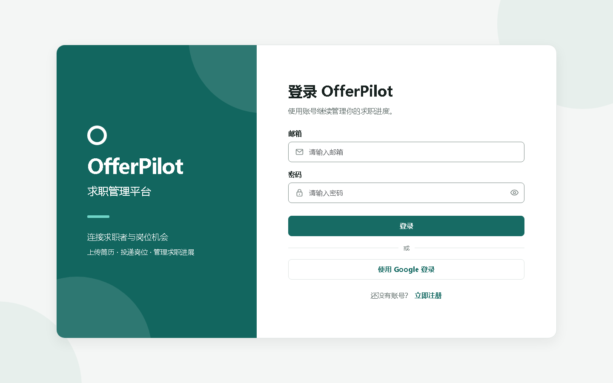
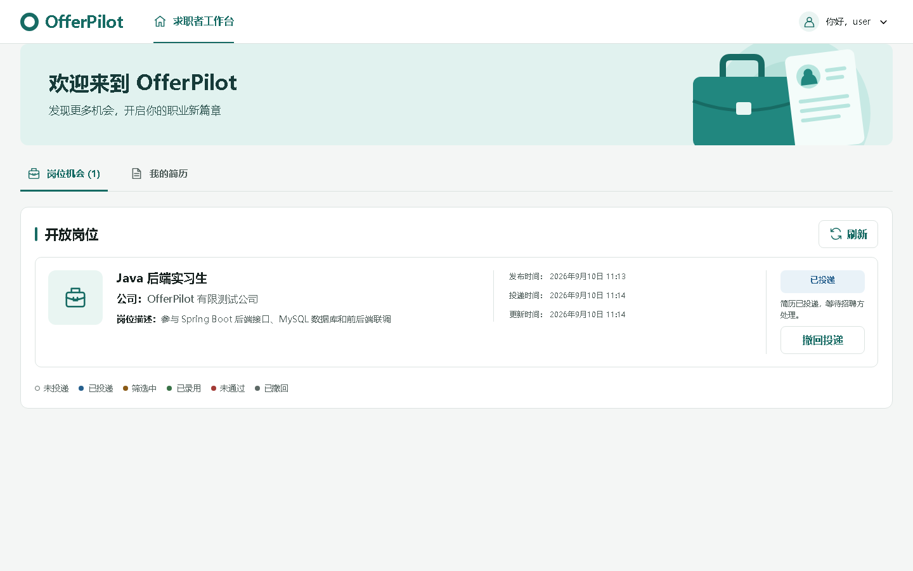
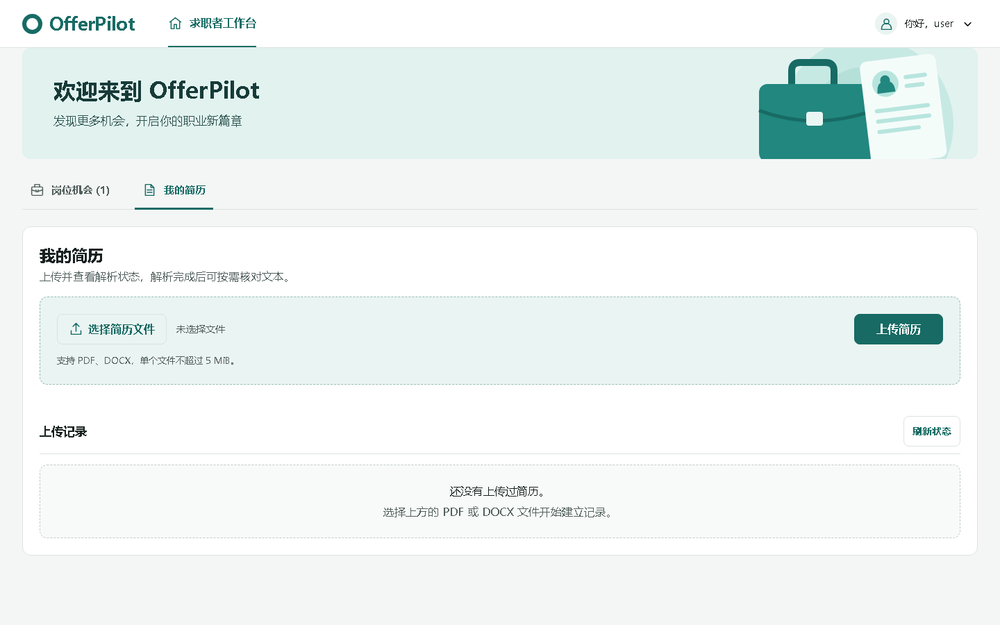
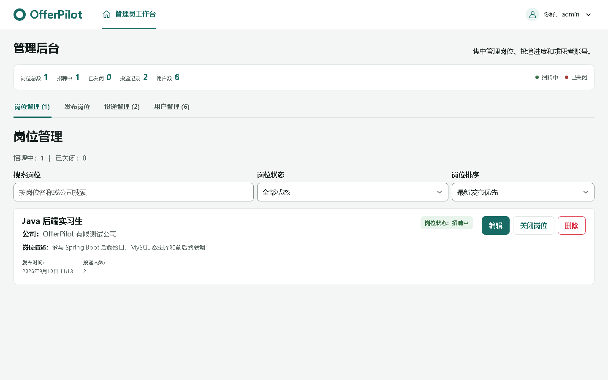

# OfferPilot 求职管理平台

OfferPilot 是面向求职者与招聘管理员的全栈求职管理平台。当前后端提供岗位浏览、投递跟踪、后台管理、简历文件管理与异步文本解析，以及 Redis 岗位查询缓存和基础可观测性；前端已完成双角色工作台与 320–1920 响应式改版（2026-11）。

> 本项目基于 [jrodolfo/job-portal](https://github.com/jrodolfo/job-portal) 的 `main` 分支进行二次开发，上游引入版本与开发原则见 [UPSTREAM.md](./UPSTREAM.md)。上游代码遵循 [MIT License](./LICENSE)，原作者版权与许可证声明均予以保留。本项目只将实际新增、重构和验证过的内容作为二次开发成果。
>
> 需要在不读代码的情况下完整理解项目（定位、流程、架构、难点、原创/二次创作归属）？见 [项目技术档案](./docs/PROJECT-BRIEF.md)。

[查看上游英文说明](./README.md)

## 界面预览

桌面端 1440×900：

| 登录 | 岗位机会 |
| --- | --- |
|  |  |
| **我的简历** | **管理后台** |
|  |  |

手机端：[求职者岗位机会 390×844](docs/ui-redesign/screenshots/applicant-jobs-390x844.png) · [登录 390×844](docs/ui-redesign/screenshots/login-390x844.png)。更多尺寸、后台页签与改版前后对照见 [截图索引](./docs/ui-redesign/SCREENSHOTS.md)。

## 2026-11 前端改版

- 认证页：40:60 双栏 + O 环品牌、共享 `AuthBrand` / `AuthInput` / `Icon`，图标输入与密码显隐。
- 求职者工作台：欢迎区、图标页签、纵向岗位记录；只读投递状态不再渲染重复操作按钮。
- 简历工作台：真实文件输入 + 自定义触发按钮 + 已选文件名；解析状态、按需加载文本与规则匹配。
- 管理后台：统一记录/筛选/状态控件；页签支持方向键、Home/End 与 roving tabindex。
- 320 / 390 / 600 / 768 / 900 / 1024 / 1440 / 1920 响应式验证；控件 ≥44px、可见键盘焦点、遵循 `prefers-reduced-motion`。

详见 [UI 改版交付与验收](./docs/ui-redesign/README.md)。

## 当前功能

求职者可以注册并登录账号，浏览招聘中的岗位，提交、撤回或再次提交申请，并在个人看板查看投递状态和更新时间。求职者还可在“我的简历”工作台上传 PDF/DOCX 简历、查看异步解析状态与提取文本、下载原文件，并将解析成功的简历与开放岗位进行规则技能覆盖率比较。管理员可以发布、编辑、关闭、重新开放或删除岗位，按状态审核投递记录，并启用或停用求职者账号。

当前认证方式包括邮箱密码登录、JWT 会话校验与可选的 Google OAuth2 登录。公开岗位列表、管理员岗位列表和岗位详情使用 Redis 缓存；缓存故障时业务读写按 fail-open 策略继续访问数据库。项目还提供 OpenAPI/Swagger 接口文档、Actuator/Prometheus 指标，以及基于 OpenTelemetry 和 Jaeger 的本地链路追踪。

## 技术栈

- 后端：Java 21、Spring Boot 3.4、Spring Security、Spring Data JPA、Flyway、MySQL 8、Redis 7、RabbitMQ 4.2、Apache Tika 3.3
- 前端：React 19、Vite 6、Redux Toolkit、React Router、Axios、Bootstrap
- 测试：JUnit 5、Spring Boot Test、Vitest、Testing Library、MSW、Playwright
- 工程化：Docker Compose、OpenAPI、Spring Boot Actuator、Prometheus、OpenTelemetry、Jaeger、GitHub Actions

## Windows + Docker 快速启动

需要先安装并启动 Docker Desktop。在项目根目录打开 PowerShell，执行：

```powershell
Copy-Item .env.example .env   # 可选：按需修改数据库/Redis/RabbitMQ/JWT 凭据
docker compose up -d --build
```

首次构建需要下载镜像和依赖，可能耗时数分钟。启动完成后可访问：

- 前端：http://localhost:5173
- 后端：http://localhost:8080
- Swagger：http://localhost:8080/swagger-ui.html
- 健康检查：http://localhost:8080/actuator/health
- Jaeger：http://localhost:16686
- RabbitMQ 管理界面：http://localhost:15672（账号可通过 `RABBITMQ_USER`、`RABBITMQ_PASSWORD` 覆盖）

查看服务状态或停止服务：

```powershell
docker compose ps
docker compose down
```

日常开发无需重置数据库卷。只有明确需要清空本地数据库时，才使用 `docker compose down -v`。

## 演示账号

| 角色 | 邮箱 | 密码 |
| --- | --- | --- |
| 求职者 | `user@local.test` | `user123` |
| 管理员 | `admin@local.test` | `admin123` |

也可以直接在登录页注册新的求职者账号。Google 登录需要额外配置 OAuth2 凭据，邮箱密码登录不受影响。

## 本地测试

后端测试使用 Maven 3.9.11 及 Java 21：

```powershell
mvn -f job-portal-backend/pom.xml test
```

前端测试与构建：

```powershell
Set-Location job-portal-frontend
npm ci
npm run lint
npm test
npm run build
```

Playwright 端到端测试需要完整服务已启动，并安装对应浏览器：

```powershell
npx playwright install chromium
npm run test:e2e
```

## 缓存指标

Actuator 只暴露 `health` 和 `prometheus`：健康检查允许匿名访问，Prometheus 端点要求 `ADMIN` 身份。可使用本地管理员账号查看指标：

```powershell
curl.exe -u admin@local.test:admin123 http://localhost:8080/actuator/prometheus
```

Redis 职位缓存启用了本进程统计。重点指标为：

- `offerpilot_cache_requests_total{cache,result}`：固定三个职位缓存的 `hit`/`miss`；
- `offerpilot_cache_fail_open_errors_total{cache,operation}`：被 fail-open 吸收的 `read`、`write`、`eviction`、`clear` 错误；
- `offerpilot_job_repository_loads_total{query="open-jobs"}`：`getOpenJobs` 缓存方法体实际执行并调用固定 Repository 查询路径的次数，不代表任意 SQL 数；
- Spring Boot 同时提供标准缓存和 HTTP/JVM 指标。

指标不会包含缓存 key、请求参数或用户信息；`cache`、`operation`、`result` 都是有限枚举。hit/miss 是单个后端进程从启动开始累计的 Redis 客户端本地统计，不是 Redis 服务端全局命中率。

## 简历文件 API

简历接口只允许 `APPLICANT` 访问，支持的文件格式为 PDF 与 DOCX，单文件上限为 5 MiB。后端会检查 PDF 文件头，或检查 DOCX 的 ZIP 包结构、必需条目、条目数量与解压扫描上限，不以客户端声明的扩展名、Content-Type 作为唯一判断依据。上传成功后返回稳定的简历 `id` 和 `QUEUED` 状态；列表与详情只返回允许用户查看的元数据、解析状态和安全错误码，不返回内部存储键、服务器路径或完整内部异常。

| 方法 | 路径 | 说明 |
| --- | --- | --- |
| `POST` | `/api/resumes` | 以 `multipart/form-data` 的 `file` 字段上传简历 |
| `GET` | `/api/resumes` | 按创建时间和 id 倒序查询当前求职者的简历元数据 |
| `GET` | `/api/resumes/{id}` | 查询本人简历详情；解析完成后包含 `extractedText` |
| `GET` | `/api/resumes/{id}/matches` | 动态计算本人已解析简历与最多 100 个开放岗位的规则技能覆盖率 |
| `GET` | `/api/resumes/{id}/content` | 下载当前求职者本人的简历；不存在或不属于本人均返回 404 |

本地直接运行时，文件默认写入 `./data/resumes`。该目录保存用户上传内容，已从 Git 和 Docker 构建上下文中排除，不应手动提交。可使用 `RESUME_STORAGE_ROOT` 修改目录，使用 `RESUME_MAX_FILE_SIZE` 和 `RESUME_MAX_REQUEST_SIZE` 调整 Web 层上传限制；业务层仍执行 5 MiB 上限校验。Docker Compose 将目录设置为 `/app/data/resumes`，并挂载 `resume-data` 命名卷，因此重建 backend 容器不会丢失文件。

当前文件实现仍是单实例本地存储：多个后端副本不能自动共享文件，也不提供对象存储级别的高可用、跨节点一致性或备份能力。文件操作位于可替换的存储接口之后，后续可接入 MinIO 等共享对象存储。本阶段尚未提供简历删除。

### 异步解析与可靠性边界

上传流程先安全写入文件，再在同一数据库事务中保存 `Resume` 与 Outbox 事件；事务或提交失败时会补偿删除刚写入的文件。Outbox 调度器以短租约、小批量领取待发布事件，并使用 RabbitMQ publisher confirm 与 mandatory return 判定投递结果。只有消息被确认且未退回时才标记为已发布；RabbitMQ 暂时不可用不会阻止后端启动，事件会保留并按有上限的指数退避重试。这解决了“数据库已写入但消息丢失”的双写窗口，但允许“消息已送达、发布状态尚未写回”造成重复投递。

RabbitMQ 主队列、交换机和消息均为持久化配置。消费者采用至少一次语义，并在数据库中锁定对应简历行：已成功的重复事件直接确认，不会再次提取。真实解析失败会单独持久化次数与安全错误码，默认最多 3 次，重试耗尽后状态为 `FAILED`，消息拒绝并由 RabbitMQ 路由到最终 DLQ；不存在、版本不兼容等陈旧事件不会无限重排。已发布 Outbox 行暂时保留作审计。

文本提取使用 Apache Tika 3.3.2，仅根据数据库中已验证的规范 PDF/DOCX MIME 选择解析器。PDF 禁用 OCR，嵌入附件不递归解析；输出统一换行、去除首尾空白，并硬限制为最多 100,000 字符。当前解析发生在后端 JVM 内：HTTP 请求已经与解析工作解耦，也有输入文件与输出长度限制，但这不是恶意文档 CPU/内存的硬进程隔离；生产环境应进一步将解析器放入具备资源配额的独立工作进程或容器。

### 开放岗位规则匹配

解析成功且文本非空的本人简历可以调用 `/api/resumes/{id}/matches`。后端一次读取按创建时间、id 倒序限制的最多 100 个 `OPEN` 岗位，并在请求时动态计算，不保存匹配结果。响应不包含简历全文、哈希、存储键或服务器路径；非本人或不存在的简历统一返回 404，尚未解析成功的简历返回 409。

当前算法版本固定为 `technical-skills-v1`。它使用集中维护的有限技术词典及别名，从简历文本和岗位标题、描述中识别 Java、Spring Boot、MySQL、Redis、RabbitMQ、Docker、Kubernetes、Kafka、Elasticsearch、Git、Maven、Gradle、JUnit、Mockito、REST API、Microservices、React、Vue、TypeScript、JavaScript、HTML、CSS、AWS。识别执行 Unicode 归一化、大小写无关和技术词边界检查，例如不会因 `JavaScript` 而误报 `Java`。

可比较岗位的整数分数为“简历匹配技能数 ÷ 岗位识别技能数 × 100”（四舍五入）；岗位未识别到词典技能时返回 `score=null`、`comparable=false`，前端明确显示“不可比较”。结果按可比较优先、分数降序、岗位创建时间降序和 id 降序排列。这只是可解释的规则技能覆盖率，不是 AI、语义理解、候选人能力评价或招聘结论；词典外技能、经验年限、熟练度和上下文否定均不在当前能力范围内。

常用配置如下，时长使用 Spring `Duration` 格式；数值还会经过应用边界校验：

| 环境变量 | 默认值 | 说明 |
| --- | --- | --- |
| `RABBITMQ_HOST` / `RABBITMQ_PORT` | `localhost` / `5672` | RabbitMQ 连接地址 |
| `RABBITMQ_USER` / `RABBITMQ_PASSWORD` | 本地开发值 | RabbitMQ 凭据；生产环境必须覆盖且不要写入日志 |
| `RESUME_OUTBOX_POLL_INTERVAL` / `RESUME_OUTBOX_BATCH_SIZE` | `1s` / `20` | Outbox 扫描周期与批量 |
| `RESUME_OUTBOX_CLAIM_LEASE` | `30s` | 多实例发布领取租约 |
| `RESUME_OUTBOX_INITIAL_BACKOFF` / `RESUME_OUTBOX_MAX_BACKOFF` | `1s` / `1m` | 发布失败退避范围 |
| `RESUME_PARSE_MAX_ATTEMPTS` | `3` | 消费解析总尝试次数 |
| `RESUME_PARSE_INITIAL_BACKOFF` / `RESUME_PARSE_MAX_BACKOFF` | `500ms` / `5s` | 消费重试退避范围 |
| `RESUME_TEXT_MAX_CHARACTERS` | `100000` | 提取文本上限；不能超过硬上限 100,000 |

## 缓存开关对照基准

完整环境启动后，可运行 Windows PowerShell 脚本：

```powershell
powershell -NoProfile -ExecutionPolicy Bypass -File .\scripts\benchmark\Measure-JobCache.ps1 `
  -Rounds 3 -RequestsPerRound 200 -Concurrency 20 -WarmupRequests 10 `
  -FixtureJobCount 100 -MinimumJobCount 100
```

脚本可通过现有管理员 API 创建仅属于本次唯一 marker 的临时 OPEN 职位，在同一个 backend 镜像上依次重建 cache-disabled 与 cache-enabled 场景，每个场景执行相同预热及多轮请求，记录 QPS、P50/P95/P99 和预热后的 Repository 回源次数，并校验所有响应的职位数量与 SHA-256 完全一致。Redis 场景只删除公开职位列表对应的一个已知键；脚本结束或失败时都会恢复进入前 backend 的实际缓存模式，只按捕获的具体 ID 清理本次 fixture，并验证原始职位 count/SHA 已恢复。

正式记录结果时必须保持 `SPRING_JPA_SHOW_SQL=false`；示例中的 100 不是通用标准。输出百分比只适用于本次同机、本地、特定数据量和参数的受控实验，不代表生产容量或 SLA。强制终止进程仍可能绕过 `finally`，人工残留检查、参数、凭据处理、任务清理与恢复边界详见 [职位缓存对照基准说明](./docs/performance/README.zh-CN.md)。

## 版本范围说明

`v0.2.0` 在既有中文产品基线上加入 Redis 职位查询缓存、缓存故障 fail-open、缓存命中/失败指标、受保护的 Prometheus 端点和可复现的 cold/warm 基准脚本，没有修改 Java 包名或数据库结构。

2026-11 在此基线上追加前端视觉、响应式与可访问性改版，不改变 API 契约、数据库结构或路由；前端改版记录见 [docs/ui-redesign](./docs/ui-redesign/README.md)。

本版本不包含基于模型的 AI 匹配、简历删除、MinIO、限流、验证码或跨实例聚合缓存统计。后续计划包括：完善移动端与可访问性体验；增加限流和验证码；将 Tika 解析隔离为受资源配额约束的独立工作进程；扩展简历版本管理、可配置岗位匹配分析与投递数据统计；补充完整的生产容量验证和部署说明。

## 已知限制与边界

- **二次开发**：岗位 CRUD、基础 JWT、Docker Compose 骨架、CI 与 ADR 来自 MIT 上游；简历异步解析、规则匹配、缓存/可观测性、认证收敛与前端改版为本地新增或重构。详见 [UPSTREAM.md](./UPSTREAM.md) 与 [项目技术档案](./docs/PROJECT-BRIEF.md)。
- **不是 AI**：岗位匹配是 23 个技术关键词的规则覆盖率，不评价候选人、不输出录用概率。
- **单实例文件存储**：当前使用本地磁盘，多副本不共享文件；`ResumeStorage` 接口可替换为 MinIO/S3。
- **无分页/限流**：岗位、投递、用户列表均为全量返回；登录与上传未做限流或验证码。
- **Google 登录需配置**：需要真实 `GOOGLE_CLIENT_ID` / `GOOGLE_CLIENT_SECRET`；未配置时邮箱密码登录不受影响。
- **本地可运行版本**：仓库提供 Docker Compose 一键启动，未提供线上 Demo 或生产 SLA。

## 相关文档

- [项目技术档案（定位、架构、流程、归属）](./docs/PROJECT-BRIEF.md)
- [简历技术点与面试素材](./docs/resume-points.md)
- [UI 改版交付与验收](./docs/ui-redesign/README.md)
- [职位缓存对照基准说明](./docs/performance/README.zh-CN.md)
- [架构决策记录](./docs/adr/)
- [上游来源与二次开发原则](./UPSTREAM.md)
